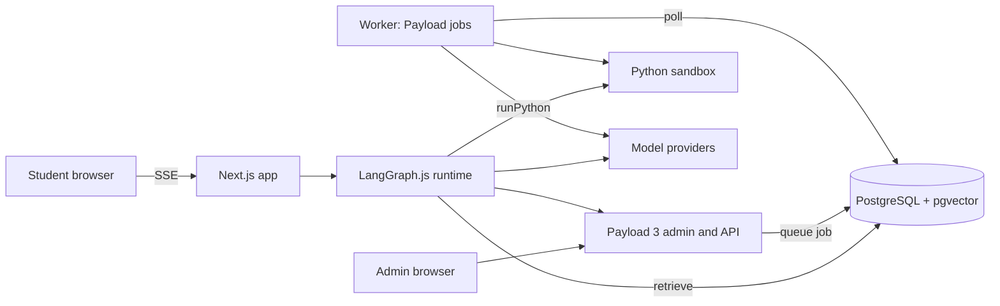

# Markhall — Architecture & Implementation Blueprint

Nov 6, 2026 · @Adil Khursheed

## Decisions and assumptions

Markhall is one TypeScript monorepo: Next.js and Payload 3 in a single app, LangGraph.js agents inside it, and one small Python sandbox container whose only job is exact math.

- **Agent runtime:** LangGraph.js (LangChain JS) running in the Next.js server process. No separate Python agent service.
- **Math execution:** Python runs only in an isolated sandbox sidecar (Docker, no network, read-only filesystem, CPU, memory and 10 s time limits), called as a tool over HTTP. SymPy is the main library.
- **Hosting:** Docker Compose on a VPS with five services: `web` (Next.js + Payload), `worker` (Payload jobs runner), `postgres` (pgvector image), `sandbox`, and `redis` (rate limits, optional).
- **LLM:** provider-agnostic. Every agent asks a `getModel(role)` factory for a LangChain chat model, and ingestion asks `getEmbedder()`. Provider, model name and embedding dimension come from env vars.
- **Languages:** English at launch. Every chunk and question carries a `language` field, and the embedding model should be multilingual so Hindi can be added without a rebuild.
- **Streaming:** server-sent events from a Next.js route handler, using LangGraph's `streamEvents`.

Confirmed answers that shaped the design:

- **Source PDFs:** digital files from board sites, so text extraction is the normal path and vision transcription is only a per-page fallback.
- **Student uploads:** students can send photos or scans of handwritten work and textbook questions with a doubt; a vision step transcribes them before the doubt flow.
- **Mock tests:** generated questions also power timed, scored mock tests.
- **Review:** AI-generated questions are gated by the `status` field (`draft`, `in_review`, `published`, `rejected`) and only `published` items reach students.

## 1. System architecture

&#91;embedded content: architecture · 2 browsers, 4 services, 1 web container\]

Student chat requests stream from the web container into the LangGraph runtime, which retrieves from pgvector, computes in the sandbox and calls the model providers. Admin uploads become jobs in Postgres that the worker picks up; it needs no extra queue service.

### Mermaid source



## 2. Payload collection schemas and pgvector

Payload owns every relational collection. Vectors live in one sidecar table, `content_embeddings`, that holds a copy of the filter columns next to each vector so the database can filter and rank in a single query.

| Collection | Purpose | Key fields |
| --- | --- | --- |
| `users` (auth) | Admins and students | `role`, `board`, `classLevel`, `preferredLanguage` |
| `subjects` | Board + class + subject | `board`, `classLevel`, `name`, `code`, `academicYear` |
| `chapters` | Syllabus units | `subject`, `number`, `title`, `weightageMarks` |
| `source-documents` (upload) | Raw PDFs from admins | `docType`, `board`, `classLevel`, `subject`, `year`, `language`, `ingestStatus`, `fileHash` |
| `knowledge-base` | Syllabus chunks and blueprint rules | `kind`, `chapter`, `content`, `blueprint`, `pageRange`, `contentHash` |
| `question-bank` | PYQs, sample items, AI-generated items | `stem`, `type`, `marks`, `difficulty`, `canonicalSolution`, `verification`, `origin`, `status` |
| `topic-mastery` | Weak and strong topics per student | `user`, `chapter`, `attempts`, `correct`, `mastery` (0 to 1), `lastSeenAt` |
| `doubt-threads` | Tutor conversations | `user`, `chapter?`, `messages[]`, `flagged` |
| `attempts` | Student answers to bank questions | `user`, `question`, `answer`, `isCorrect`, `timeMs` |

Weak and strong topics sit in `topic-mastery`, not as an array on `users`: the array would grow without bound and every update would rewrite the user row.

### Mock tests and student uploads

Three more collections support scored mock tests and handwritten-work uploads.

| Collection | Purpose | Key fields |
| --- | --- | --- |
| `mock-tests` | A fixed paper built from the bank | `board`, `classLevel`, `subject`, `durationMinutes`, `totalMarks`, `negativeMarking`, `sections[]` (name, instructions, `questions[]` relation, `marksEach`), `generatedFor?` (user), `blueprintSnapshot` (json), `status` |
| `mock-attempts` | One student's run of a test | `user`, `test`, `startedAt`, `deadlineAt` (set by the server), `submittedAt`, `answers[]` (`question`, `response`, `images[]`, `autoScore`, `aiScore`, `finalScore`, `feedback`, `gradingStatus`), `totalScore`, `status` |
| `student-uploads` (upload) | Photos and scans from students | `owner`, `purpose` (doubt or answer), `thread?`, `attempt?`, `transcription`, `transcriptionConfidence`, `retentionUntil` |

Rules that go with them:

- **Owner-only access.** `student-uploads` and `mock-attempts` are readable only by their owner and admins. Uploads accept JPEG, PNG and WebP up to a size cap (for example 8 MB), and a scheduled job deletes files after `retentionUntil`.
- **Assembly before the clock starts.** A test is built from the `blueprint` marks pattern, with extra weight on the student's weak chapters. Published bank items are used first; missing slots are filled by generation jobs queued before the test begins, so model latency never eats into the timer.
- **Server-side timer.** `deadlineAt` is computed on the server at start. Autosave writes are accepted until then, and the submit endpoint rejects late answers.
- **Grading.** MCQ and numerical answers are scored by code (numerical answers checked in the sandbox with a stated tolerance). Written answers are scored by the `grade_answer` node against the canonical solution and marking-scheme steps. Low-confidence grades set `gradingStatus: 'needs_review'` instead of reaching the student as final.
- **Review gate.** A `mock-tests` row follows the same `status` values as `question-bank`. A test is `published` only when every question in it is `published`.

### Core collection configs

```ts
// collections/QuestionBank.ts
import type { CollectionConfig } from 'payload'
import { enqueueEmbedding, removeEmbedding } from '../jobs/enqueue'

export const QuestionBank: CollectionConfig = {
  slug: 'question-bank',
  admin: { useAsTitle: 'stem', defaultColumns: ['stem', 'board', 'classLevel', 'difficulty', 'status'] },
  access: {
    read: ({ req }) => (req.user?.role === 'admin' ? true : { status: { equals: 'published' } }),
    create: ({ req }) => req.user?.role === 'admin',
    update: ({ req }) => req.user?.role === 'admin',
  },
  fields: [
    { name: 'stem', type: 'textarea', required: true }, // Markdown + LaTeX
    { name: 'type', type: 'select', required: true, options: ['mcq', 'short', 'long', 'numerical', 'assertion_reason', 'case_based'] },
    { name: 'options', type: 'array', admin: { condition: (_, s) => s?.type === 'mcq' },
      fields: [{ name: 'text', type: 'text', required: true }, { name: 'isCorrect', type: 'checkbox' }] },
    { name: 'marks', type: 'number', required: true },
    { name: 'difficulty', type: 'number', min: 1, max: 5, required: true },
    { name: 'board', type: 'select', required: true, index: true, options: ['cbse', 'icse', 'up'] },
    { name: 'classLevel', type: 'number', required: true, index: true },
    { name: 'subject', type: 'relationship', relationTo: 'subjects', required: true, index: true },
    { name: 'chapter', type: 'relationship', relationTo: 'chapters', index: true },
    { name: 'language', type: 'select', defaultValue: 'en', options: ['en', 'hi'] },
    { name: 'canonicalSolution', type: 'textarea', required: true }, // step-by-step, LaTeX
    { name: 'finalAnswer', type: 'text' },
    { name: 'verification', type: 'json' }, // { script, stdout, verifiedAt, engine: 'sympy' }
    { name: 'origin', type: 'select', required: true, options: ['pyq', 'sample', 'ai_generated'] },
    { name: 'pyqYear', type: 'number', admin: { condition: (_, s) => s?.origin === 'pyq' } },
    { name: 'sourceDocument', type: 'relationship', relationTo: 'source-documents' },
    { name: 'status', type: 'select', defaultValue: 'draft', index: true, options: ['draft', 'in_review', 'published', 'rejected'] },
    { name: 'reviewedBy', type: 'relationship', relationTo: 'users' },
  ],
  hooks: {
    afterChange: [async ({ doc, previousDoc, req }) => {
      if (doc.stem !== previousDoc?.stem || doc.status !== previousDoc?.status) {
        await enqueueEmbedding(req.payload, 'question', doc.id)
      }
    }],
    afterDelete: [async ({ id, req }) => { await removeEmbedding(req.payload, 'question', id) }],
  },
}
```

```ts
// collections/Users.ts: additions to the auth collection
fields: [
  { name: 'role', type: 'select', defaultValue: 'student', options: ['student', 'admin'], required: true, saveToJWT: true },
  { name: 'board', type: 'select', options: ['cbse', 'icse', 'up'], saveToJWT: true },
  { name: 'classLevel', type: 'number', min: 6, max: 12, saveToJWT: true },
  { name: 'preferredLanguage', type: 'select', defaultValue: 'en', options: ['en', 'hi'] },
]
```

`knowledge-base` follows the same pattern as `question-bank`: filter fields (`board`, `classLevel`, `subject`, `chapter`, `language`), a `kind` (`syllabus_topic`, `learning_outcome`, `exam_pattern`, `marking_scheme`), `content`, a `blueprint` JSON field (marks per section, question-type mix, internal choice rules) and a `contentHash` so unchanged chunks are never re-embedded.

### pgvector sidecar table

Create it in a Payload migration (`payload migrate:create`) and keep `push` off outside local dev, so Drizzle never tries to drop a table it does not know about. Better still, declare the table in the adapter's `beforeSchemaInit` hook with Drizzle's `vector()` column so Payload's schema knows it exists; check that hook's exact signature against your installed Payload version.

```sql
CREATE EXTENSION IF NOT EXISTS vector;

CREATE TABLE content_embeddings (
  id           bigserial PRIMARY KEY,
  source_type  text     NOT NULL CHECK (source_type IN ('knowledge', 'question')),
  source_id    integer  NOT NULL,            -- Payload's serial id
  board        text     NOT NULL,
  class_level  smallint NOT NULL,
  subject_id   integer  NOT NULL,
  chapter_id   integer,
  language     text     NOT NULL DEFAULT 'en',
  difficulty   smallint,
  status       text     NOT NULL DEFAULT 'published',
  content_hash text     NOT NULL,
  embedding    vector(1024) NOT NULL,        -- set to your embedding model's dimension
  UNIQUE (source_type, source_id)
);

CREATE INDEX content_embeddings_hnsw ON content_embeddings
  USING hnsw (embedding vector_cosine_ops) WITH (m = 16, ef_construction = 64);
CREATE INDEX content_embeddings_filter ON content_embeddings
  (source_type, board, class_level, subject_id, chapter_id, status);
```

### Metadata-filtered search through Payload's Drizzle handle

Queries run on `payload.db.drizzle`, the same connection pool Payload uses. Rows are then hydrated through `payload.find`, so access control and field hooks still apply.

```ts
// lib/vector/search.ts
import { sql } from 'drizzle-orm'
import type { Payload } from 'payload'

type Filter = {
  board: string; classLevel: number; sourceType: 'knowledge' | 'question'
  subjectId?: number; chapterId?: number; language?: string; maxDifficulty?: number
}

export async function vectorSearch(payload: Payload, queryVec: number[], f: Filter, limit = 8) {
  const v = `[${queryVec.join(',')}]`
  const rows = await payload.db.drizzle.transaction(async (tx) => {
    // pgvector 0.8+: iterative scans keep filtered HNSW queries from returning too few rows
    await tx.execute(sql`SET LOCAL hnsw.iterative_scan = relaxed_order`)
    await tx.execute(sql`SET LOCAL hnsw.ef_search = 100`)
    const res = await tx.execute(sql`
      SELECT source_id, 1 - (embedding <=> ${v}::vector) AS score
      FROM content_embeddings
      WHERE source_type = ${f.sourceType}
        AND board = ${f.board} AND class_level = ${f.classLevel}
        AND status = 'published'
        ${f.subjectId ? sql`AND subject_id = ${f.subjectId}` : sql``}
        ${f.chapterId ? sql`AND chapter_id = ${f.chapterId}` : sql``}
        ${f.language ? sql`AND language = ${f.language}` : sql``}
        ${f.maxDifficulty ? sql`AND difficulty <= ${f.maxDifficulty}` : sql``}
      ORDER BY embedding <=> ${v}::vector
      LIMIT ${limit}`)
    return res.rows as { source_id: number; score: number }[]
  })
  if (!rows.length) return []
  const collection = f.sourceType === 'question' ? 'question-bank' : 'knowledge-base'
  const { docs } = await payload.find({
    collection, where: { id: { in: rows.map((r) => r.source_id) } }, limit: rows.length, depth: 0,
  })
  const byId = new Map(docs.map((d) => [d.id, d]))
  return rows.flatMap((r) => (byId.has(r.source_id) ? [{ ...byId.get(r.source_id)!, score: r.score }] : []))
}
```

Two design notes:

- Board, class, subject and chapter are hard filters and never part of the embedded text. Writing "CBSE Class 10" into that text would blur boards that share chapter names.
- For a single board, class and subject the candidate set is small, so Postgres may pick the btree filter index and scan exactly. That is fine and even more accurate; the HNSW index matters once the bank grows.

## 3. Admin ingestion pipeline

The upload request only stores the file and queues a job; everything slow runs in the `worker` container. The Admin UI stays responsive and shows `ingestStatus` live in the list view.

1. **Upload.** An admin adds a PDF to `source-documents` with `docType` (syllabus, sample paper, PYQ), board, class, subject, year and language. Files go to a mounted volume or an S3-compatible store such as MinIO.
2. **Deduplicate.** A `beforeChange` hook computes the SHA-256 of the file and rejects a second upload with the same hash and metadata.
3. **Queue.** An `afterChange` hook sets `ingestStatus: 'pending'` and calls `payload.jobs.queue({ workflow: 'ingestDocument', input: { documentId } })`, then returns.
4. **Run.** The `worker` container is the only process with `jobs.autoRun` enabled (switched on by an env flag). It picks up jobs every minute, and each workflow task retries on its own.
5. **Extract.** The board PDFs are digital, so the default is text per page with layout. Pages where math extracts badly (broken fractions, lost symbols) or the text layer is empty: render the page to an image and have a vision-capable model transcribe it to Markdown with LaTeX. Choose per page by checking how much text the PDF text layer returns.
6. **Segment.** A syllabus splits at its chapter and topic headings into chunks of about 200 to 500 tokens. Papers split at question numbers and section headers. A model with structured output (zod schema) returns each question's `stem`, `type`, `marks`, any `options`, and the `solution` when the paper includes one.
7. **Classify.** For each question, the model picks one chapter from the closed list of that subject's chapters, plus a difficulty estimate. A closed list prevents invented chapter names.
8. **Verify numerics.** Numerical questions with a given answer go through the Python sandbox. A mismatch sets the item to `in_review` with a note for the admin.
9. **Persist.** Create `knowledge-base` and `question-bank` rows, keyed by `contentHash` so a re-run updates instead of duplicating. PYQs and sample items arrive as `draft` and go live after admin review.
10. **Embed.** Batch about 64 texts per call. The embedded text is a context header plus the content, for example `Chapter: Quadratic Equations. Topic: Nature of roots. ...`. Upsert into `content_embeddings` with the copied filter columns; skip rows whose `contentHash` is unchanged.
11. **Finish.** Set `ingestStatus: 'ready'` with counts (chunks, questions, flagged). On a final failure set `failed` and store the error text so the admin can use a Re-ingest button.

Keep workflow outputs small: tasks pass ids and counts, and page text lives in a `source-pages` table or on disk. Payload stores each task's output in the job record, so large payloads slow the queue.

```ts
// jobs/ingestDocument.ts (shape only; check the Jobs API against your Payload version)
import type { WorkflowConfig } from 'payload'

export const ingestDocument: WorkflowConfig<'ingestDocument'> = {
  slug: 'ingestDocument',
  inputSchema: [{ name: 'documentId', type: 'number', required: true }],
  retries: 1,
  handler: async ({ job, inlineTask }) => {
    const { documentId } = job.input
    await inlineTask('extract', { retries: 2, task: async ({ req }) => ({ output: await extractPages(req.payload, documentId) }) })
    await inlineTask('segment', { retries: 2, task: async ({ req }) => ({ output: await segmentDocument(req.payload, documentId) }) })
    await inlineTask('classify', { retries: 3, task: async ({ req }) => ({ output: await classifyItems(req.payload, documentId) }) })
    await inlineTask('verify', { retries: 1, task: async ({ req }) => ({ output: await verifyNumerics(req.payload, documentId) }) })
    await inlineTask('persist', { retries: 2, task: async ({ req }) => ({ output: await persistItems(req.payload, documentId) }) })
    await inlineTask('embed', { retries: 3, task: async ({ req }) => ({ output: await embedDocumentItems(req.payload, documentId) }) })
    await inlineTask('finish', { task: async ({ req }) => ({ output: await markReady(req.payload, documentId) }) })
  },
}
```

```ts
// collections/SourceDocuments.ts (hook excerpt)
hooks: {
  afterChange: [async ({ doc, operation, req }) => {
    if (operation === 'create') {
      await req.payload.update({ collection: 'source-documents', id: doc.id, data: { ingestStatus: 'pending' }, req })
      await req.payload.jobs.queue({ workflow: 'ingestDocument', input: { documentId: doc.id } })
    }
  }],
}
```

The same `embedContent` task, queued from the `afterChange` hooks of `knowledge-base` and `question-bank`, keeps vectors in sync when an admin edits a single row by hand.

## 4. LangGraph agent graph

The "multi-agent" system is one LangGraph.js graph with specialised nodes, not free-roaming agents. A fixed topology makes every path testable, bounds cost, and lets us guarantee that math is computed before it is explained.

### The central rule: numbers come from code, never from the model

The solver writes a short SymPy script that prints one JSON object of named values, each with an exact LaTeX form and a numeric form. The explainer then writes the step-by-step solution using placeholders such as `<<v:root1>>` wherever a computed value belongs. A deterministic function replaces each placeholder with the sandbox's LaTeX string. The model cannot mistype a result because it never writes one. A leftover placeholder or an unknown key fails validation.

### State

```ts
// agents/state.ts
import { Annotation, MessagesAnnotation } from '@langchain/langgraph'

export const TutorState = Annotation.Root({
  ...MessagesAnnotation.spec,
  student: Annotation<{ id: number; board: string; classLevel: number; language: string }>(),
  mode: Annotation<'doubt' | 'generate' | 'clarify' | 'refuse'>(),
  request: Annotation<{ text: string; subjectId?: number; chapterId?: number; count?: number; type?: string; difficulty?: number }>(),
  context: Annotation<{ syllabus: Chunk[]; similar: QuestionHit[]; blueprint?: Blueprint; mastery?: Mastery[] }>(),
  computation: Annotation<{ script?: string; values?: Record<string, { latex: string; num: string }>; ok: boolean; attempts: number; error?: string }>(),
  draft: Annotation<string>(),
  validation: Annotation<{ ok: boolean; errors: string[]; attempts: number }>(),
  questions: Annotation<GeneratedQuestion[]>({ reducer: (a, b) => a.concat(b), default: () => [] }),
})
```

### Tools

| Tool | Input (zod) | Behaviour |
| --- | --- | --- |
| `retrieveContext` | `query`, `sourceType`, filters from the student profile | Embeds the query and calls `vectorSearch` from section 2. Filters are injected by the server from the session, never chosen by the model. |
| `runPython` | `code`, `timeoutMs` | POSTs to the sandbox. Returns `{ ok, stdout, stderr, exitCode }`. Container: no network, read-only filesystem, non-root user, memory and process limits, 10 s timeout. |
| `validateLatex` | `markdown` | Extracts each `$...$` and `$$...$$` span and renders it with KaTeX using `throwOnError: true`. Returns `{ valid, errors[] }`. |
| `saveQuestionDraft` | question object | Creates a `question-bank` row with `origin: 'ai_generated'` and `status: 'in_review'`, storing the script and its stdout in `verification`. |

### Nodes and routing

| Node | Model role | Job | Next node |
| --- | --- | --- | --- |
| `guard` | small | Scope and prompt-injection check. Must be about the student's subjects. | `route`, or `refuse` if out of scope |
| `route` (orchestrator) | small | Intent: doubt or generate. Embeds the request, finds the nearest syllabus chunks, and infers subject and chapter from them. | `retrieve`, or `clarify` if top similarity is below a threshold or two chapters tie |
| `retrieve` | none | Calls `retrieveContext` for syllabus constraints and similar PYQs, and loads the student's weakest chapters from `topic-mastery`. | `solve` (doubt) or `plan_questions` (generate) |
| `solve` | strong | Writes a plan and the SymPy script. Proofs use the script to check each algebraic identity used. | `run_python` |
| `run_python` | none | Calls `runPython` and parses the JSON. | `explain` on success; `solve` with the error on failure, up to 3 attempts; otherwise `explain_unverified` |
| `explain` | strong | Writes the step-by-step answer in the student's language with `<<v:key>>` placeholders. | `validate_format` |
| `explain_unverified` | strong | Teaches the method only, states plainly that the final value could not be machine-checked, and flags the thread for admin review. | `validate_format` |
| `validate_format` | none | Substitutes placeholders, then runs `validateLatex` and structure checks (numbered steps, no leftover placeholders). | `respond`, or `repair_format` on failure |
| `repair_format` | small | Fixes the exact KaTeX error reported. | `validate_format`, up to 2 attempts, then plain-text fallback |
| `plan_questions` | strong | Reads the blueprint and PYQ patterns, and produces N specs (type, marks, difficulty, concept). Fan-out with `Send`. | one `question_worker` per spec, in parallel |
| `question_worker` (subgraph) | strong | Draft, then `run_python` to compute the answer, then check, with up to 2 retries. | `collect` |
| `collect` | none | Drops failed items and saves the rest with `saveQuestionDraft`. | `respond` |

The subgraph's `check_question` step combines rules and an LLM judge:

- The computed answer exists, is unique and fits the type (an MCQ has exactly one correct option).
- Distractors come from computing the common wrong methods in the same script, not from model guesses.
- Syllabus alignment: the concept must appear in the retrieved chunks.
- Novelty: nearest existing question in the bank scores below 0.92 cosine similarity.
- Difficulty and marks match the spec.

### Additions: image doubts and mock tests

Two features change the graph. Image doubts add an input stage and a work-checking node. Mock tests add a second, non-chat graph that runs from jobs.

**Image doubts.** The state gains `attachments` (ids from `student-uploads`) and `transcription` (`text`, `confidence`, `kind`).

| Node | Model role | Job | Next node |
| --- | --- | --- | --- |
| `read_image` | vision | Transcribes a photo or scan to Markdown with LaTeX and labels it `student_solution`, `textbook_question` or `other`. Writes the text and a confidence score to `student-uploads`. | `guard`, or `clarify` when confidence is low |
| `compare_work` | none | Runs after `run_python` when `kind` is `student_solution`. The sandbox script checks each consecutive pair of the student's steps for equivalence with SymPy and reports the first step that breaks. | `explain` |

- A low-confidence transcript is never solved silently. `clarify` shows the student what was read ("I read this as ...") and asks them to confirm, correct it or retake the photo.
- A textbook-question photo follows the normal doubt path once transcribed.
- For a handwritten solution, `explain` starts from the first wrong step the sandbox found and teaches from there, instead of re-solving the whole problem.
- Transcribed text is treated as untrusted data, like retrieved text. It passes through `guard` before anything else.

**Mock tests.** Two separate flows, neither of them live chat:

| Flow | Trigger | Steps |
| --- | --- | --- |
| Build (`buildMockTest` workflow) | Student asks for a test, or an admin schedules one | Read the blueprint and the student's weak chapters, pick `published` bank items, send `question_worker` for each missing slot, then set the test to `in_review` or `published` by the `status` rule. |
| Grade (grading graph) | Submit, or deadline reached | Transcribe any handwritten answer images with `read_image`. Fan out one branch per answer: `score_objective` for MCQ and numerical, `grade_answer` for written. Then `finalize` totals the marks and writes feedback. |

`grade_answer` receives the canonical solution split into marking points. It awards marks per point, writes feedback tied to the student's own steps, and re-checks any numeric claim through `runPython`. If its confidence is low, the answer gets `needs_review` and the student sees the score as provisional.

```ts
// agents/graph.ts: changes to the chat graph
// remove: .addEdge(START, 'guard')
.addNode('read_image', readImage)
.addNode('compare_work', compareWork)
.addConditionalEdges(START, (s) => (s.attachments?.length ? 'read_image' : 'guard'))
.addConditionalEdges('read_image', (s) => (s.transcription.confidence < 0.7 ? 'clarify' : 'guard'))
// replace the run_python edge so student work is compared before explaining
.addConditionalEdges('run_python', (s) => {
  if (s.computation.ok) return s.transcription?.kind === 'student_solution' ? 'compare_work' : 'explain'
  return s.computation.attempts < MAX_SOLVE_ATTEMPTS ? 'solve' : 'explain_unverified'
})
.addEdge('compare_work', 'explain')
```

```ts
// agents/gradingGraph.ts
export function buildGradingGraph() {
  return new StateGraph(GradingState)
    .addNode('score_objective', scoreObjective)
    .addNode('grade_answer', gradeAnswer)
    .addNode('finalize', finalizeAttempt)
    .addConditionalEdges(START, (s) =>
      s.answers.map((a) => new Send(a.kind === 'written' ? 'grade_answer' : 'score_objective', { answer: a })))
    .addEdge('score_objective', 'finalize')
    .addEdge('grade_answer', 'finalize')
    .addEdge('finalize', END)
    .compile()
}
```

### Wiring

```ts
// agents/graph.ts
import { StateGraph, START, END, Send } from '@langchain/langgraph'
import { PostgresSaver } from '@langchain/langgraph-checkpoint-postgres'

const MAX_SOLVE_ATTEMPTS = 3

export function buildGraph(checkpointer: PostgresSaver) {
  return new StateGraph(TutorState)
    .addNode('guard', guard)
    .addNode('route', route)
    .addNode('retrieve', retrieve)
    .addNode('solve', solve)
    .addNode('run_python', runPythonNode)
    .addNode('explain', explain)
    .addNode('explain_unverified', explainUnverified)
    .addNode('validate_format', validateFormat)
    .addNode('repair_format', repairFormat)
    .addNode('plan_questions', planQuestions)
    .addNode('question_worker', questionWorkerSubgraph)
    .addNode('collect', collect)
    .addNode('clarify', clarify)
    .addNode('refuse', refuse)
    .addEdge(START, 'guard')
    .addConditionalEdges('guard', (s) => (s.mode === 'refuse' ? 'refuse' : 'route'))
    .addConditionalEdges('route', (s) => (s.mode === 'clarify' ? 'clarify' : 'retrieve'))
    .addConditionalEdges('retrieve', (s) => (s.mode === 'doubt' ? 'solve' : 'plan_questions'))
    .addEdge('solve', 'run_python')
    .addConditionalEdges('run_python', (s) => {
      if (s.computation.ok) return 'explain'
      return s.computation.attempts < MAX_SOLVE_ATTEMPTS ? 'solve' : 'explain_unverified'
    })
    .addEdge('explain', 'validate_format')
    .addEdge('explain_unverified', 'validate_format')
    .addConditionalEdges('validate_format', (s) => {
      if (s.validation.ok) return END
      return s.validation.attempts < 2 ? 'repair_format' : END
    })
    .addEdge('repair_format', 'validate_format')
    .addConditionalEdges('plan_questions', (s) =>
      s.specs.map((spec) => new Send('question_worker', { spec, context: s.context, student: s.student })))
    .addEdge('question_worker', 'collect')
    .addEdge('collect', 'validate_format')
    .addEdge('clarify', END)
    .addEdge('refuse', END)
    .compile({ checkpointer })
}
```

Three operational points:

- **Persistence.** The checkpointer uses the same Postgres instance with `thread_id` set to the `doubt-threads` id, so a student can leave and resume.
- **Model roles.** Every node asks `getModel('router' | 'solver' | 'explainer' | 'judge')`; switching providers is an env change.
- **Personalisation.** `topic-mastery` feeds `plan_questions` (more items from weak chapters) and the `explain` prompt (more scaffolding where mastery is low). After a student answers, an `attempts` row and a mastery update close the loop.

## 5. Edge cases and mitigations

| Case | Risk | Mitigation |
| --- | --- | --- |
| Hindi and UP Board content | Many Hindi PDFs use legacy fonts (for example Kruti Dev) that extract as garbage; students also write Hinglish | Detect garbage by the share of characters in the Devanagari block. Below a threshold, route the page to vision transcription. Use a multilingual embedding model. Keep English `topicTags` on every chunk so a Hindi or Hinglish query still finds the English syllabus chunk. |
| Devanagari digits and Indian number formats | `१२३` or `1,00,000` break parsing in the sandbox | Normalise digits and lakh/crore separators to ASCII before the solver sees them. The reply uses the student's language; LaTeX stays universal. |
| Board-specific rules | π taken as 22/7 versus 3.14, rounding conventions, marking-scheme wording | Store rules in `knowledge-base.blueprint.rules` per board and subject. Inject them into the `solve` and `explain` prompts and the sandbox preamble. |
| Partial formulas on a stream | A half-received `$$` block renders as garbage | Block-level streaming (below). |
| Model writes a wrong number anyway | Silent error in a student's answer | Placeholders replaced from sandbox output, a leftover-placeholder check, and a thumbs-down "report wrong answer" button that creates a flagged item in the admin queue. |
| Proofs and theory questions | Not everything can be computed | Machine-check each algebraic identity used. Label the remainder "reasoned, not machine-verified". |
| Questions that need a figure | The model cannot reliably draw geometry | Launch without figure-dependent question generation. Ingestion marks such PYQs `needsFigure`, and they are excluded from the generation prompts. |
| Sandbox abuse and load | Infinite loops, memory use, queue build-up | Per-run timeout, memory and process limits, no network, a small worker pool with a queue, and per-user rate limits in Redis. |
| Prompt injection via PDFs or doubts | Instructions hidden in ingested text or a student's message | Retrieved text is passed as quoted data. Retrieval and sandbox tools never accept filters or code chosen from retrieved text. The `guard` node screens input. |
| Syllabus changes each year | Old patterns leak into new practice sets | `academicYear` on subjects and knowledge chunks. Retrieval filters to the current year. Superseded rows become `archived`. |
| Cost | Strong models on every request | Small model for `guard`, `route` and `repair_format`. Cache verified doubt answers by (normalised question, chapter, language). Cap tokens per student per day. |
| Student data | Class 6 to 12 students are mostly minors | Collect the minimum. India's DPDP Act asks for verifiable parental consent for under-18 users; check the current rules with a lawyer before launch. |
| Quality drift | Prompt or model change quietly lowers accuracy | Keep about 200 golden doubts per subject with known answers. Run them in CI on every prompt or model change, and trace every run (LangSmith or self-hosted Langfuse). |

### Handwritten uploads and mock tests

| Case | Risk | Mitigation |
| --- | --- | --- |
| Blurry, cropped or rotated photos | Wrong transcript, wasted model calls | Check size and sharpness in the browser, fix EXIF rotation, allow several images per doubt, and fall back to `clarify` when confidence is low. |
| Misread handwriting | `1` read as `7`, `x` as a multiplication sign, lost exponents | Always show the transcript in the thread. Below the confidence threshold, ask for confirmation before solving. |
| Student photos as personal data | Location in EXIF data, handwriting, names on notebooks | Strip EXIF on upload, owner-only access, delete after `retentionUntil`, and never copy uploads into `content_embeddings` or any shared index. |
| Looking up answers during a test | Mock scores stop meaning anything | Disable the tutor for questions in an active timed attempt, shuffle question and option order per attempt, and release solutions only after submit. |
| Flaky networks during a timed test | Lost answers | Autosave with a local queue and resume; only the server clock decides the deadline. |
| Disputed AI grades | Students lose trust | Show written-answer scores as provisional until reviewed; a Request review button sets `needs_review`. |
| Repeated or near-duplicate tests | Students see the same questions | Exclude questions already in the student's history, and run the novelty check against the bank before a generated item enters a test. |
| Personal versus shared tests | Unfair comparison between students | `generatedFor` marks a personal test. Leaderboards or percentiles use only shared, `published` tests. |

### Streaming LaTeX without broken formulas

Because all numbers are computed before `explain` starts, the stream layer can substitute placeholders as text arrives. It cuts the token stream into complete blocks (a paragraph, a numbered step, or a full `$$...$$` display), validates each with KaTeX, and sends only finished blocks to the browser. The block in progress shows as plain shimmering text.

```ts
// lib/stream/blockAssembler.ts
const hasOpenMath = (s: string) => {
  const display = (s.match(/\$\$/g) ?? []).length % 2 === 1
  const inline = (s.replace(/\$\$/g, '').match(/(?<!\\)\$/g) ?? []).length % 2 === 1
  return display || inline
}

export function createBlockAssembler(onBlock: (markdown: string) => void) {
  let buf = ''
  return {
    push(token: string) {
      buf += token
      let cut = buf.indexOf('\n\n')
      while (cut !== -1) {
        const block = buf.slice(0, cut)
        if (!hasOpenMath(block)) {
          onBlock(block)
          buf = buf.slice(cut + 2)
          cut = buf.indexOf('\n\n')
        } else {
          cut = buf.indexOf('\n\n', cut + 2) // a blank line inside open math: keep reading
        }
      }
    },
    flush() { if (buf.trim()) onBlock(buf); buf = '' },
  }
}
```

Rules that go with it:

- The prompt allows only `$...$` and `$$...$$`. A normaliser rewrites `\(...\)` and `\[...\]` to those forms, because `remark-math` expects dollars.
- Server events: `status` ("Computing exactly..."), `block`, `done`, `error`. Each `block` is substituted and KaTeX-checked; a bad block goes through `repair_format` alone, so the rest of the answer is untouched.
- Browser: `react-markdown` with `remark-math` and `rehype-katex`, one memoised component per block so finished blocks never re-render, and KaTeX CSS loaded once.
- Route handler: `runtime = 'nodejs'`, `dynamic = 'force-dynamic'`, a heartbeat comment every 15 s, and `X-Accel-Buffering: no` with `proxy_buffering off` on the reverse proxy so nothing is held back.
- Reconnect: the SSE `id` is the block index; the checkpointed thread lets the client resume after a dropped connection.
- The final saved message is the full text after `validate_format`, so the stored copy equals what the student saw.

### Suggested build order

1. Payload collections, auth with roles, and admin upload of `source-documents`.
2. Ingestion for one board, one class and one subject, with `content_embeddings` and `vectorSearch`.
3. Sandbox service and the text doubt flow (`guard` to `validate_format`) with the golden-doubt test set.
4. Streaming UI with block assembly and KaTeX.
5. Image uploads: `student-uploads`, `read_image` and `compare_work`.
6. Question generation subgraph with the admin review queue.
7. Mock tests: `buildMockTest` workflow, timer, grading graph.
8. Mastery tracking, personalised practice, then Hindi.
9. Rate limits, observability and the privacy review before opening to students.
